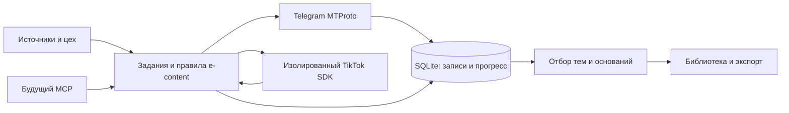

# Коннекторы цеха: выбор после проверки Zen

Статус: исследование завершено; пользователь 17 ноября 2026 года разрешил реализацию нового коннектора с нуля. Результат проверки и выбранный транспорт описаны в [tiktok-native.md](tiktok-native.md). Изначальный кандидат TikTokApi не прошёл настоящую проверку комментариев. Native-сборщик отдельно подтвердил профиль, ролики, корневые комментарии и ответы; серверная интеграция использует его закреплённую версию, сохраняя описанное ниже разделение ответственности.

## Требование

По одному сохранённому профилю автоматически выбирать последние 10–20 роликов, получать тексты комментариев и ответов, даты и доступные счётчики. В Telegram — читать доступные аккаунту каналы, посты и связанные обсуждения. Из этих оснований формировать кандидаты идей и хранить их в библиотеке. Ручные ссылки на каждый ролик, постоянные переустановки расширения и необходимость открывать цех для сохранения результатов в библиотеке не должны быть частью штатной работы.

«Бесплатно» в этом решении означает отсутствие обязательного платного scraping API, платных прокси и CAPTCHA-сервисов. Локальные вычисления и поддержка интеграции всё равно требуют ресурсов. Публикация исходников библиотеки не превращает неофициальный доступ TikTok в официальный стабильный контракт.

## Что действительно подтверждено у нас

- Zen-коннектор определил аккаунт `@egorcod` и получил 20 записей роликов с частичным покрытием профиля. Это проверка метаданных и личности, не проверка полного сбора комментариев.
- Последний настоящий запуск `zen-live-verify-1794926964305` сохранил один пост, ноль комментариев, выполнил 12 учитываемых запросов и завершился частично. У ролика `7708022666925559054` на тот момент получен счётчик 59 комментариев. Счётчик не подменяет тексты.
- Более ранний гостевой прототип однажды прочитал 20 комментариев этого ролика. Это отдельный результат; он не подтверждает нынешний аккаунтный коннектор.
- Изолированные проверки Zen/Firefox проходят на подготовленных ответах, включая отменённые запросы и позднее появление кнопки. Они не доказывают устойчивость реального TikTok.
- Telegram-адаптер использует существующий MTProto-клиент, но реальная авторизация пользователя пока не подтверждена из-за получения собственного `api_id/api_hash`.

Сведения о запуске взяты из локального API и сохранённого снимка, без нового сбора в рамках исследования.

## Почему текущий путь оказался дорогим в поддержке

Расширение выбрано, чтобы использовать действующую сессию обычного Zen и не пытаться входить через Google в автоматизированном Edge. Это решает перенос точки входа, но не решает получение данных само по себе.

Затем в собственном коде оказались ожидание загрузки страниц, определение пользователя, клики панели, прокрутка, раскрытие ответов, чтение потоков, сопоставление запросов с документами, восстановление после переходов, очередь браузера и обмен с локальным сервером. Изменение интерфейса или порядка запросов проходит через весь этот набор. Это допустимый экспериментальный транспорт, но сейчас его нельзя объявить надёжным фундаментом цеха.

Ошибкой процесса было подключать этот путь к основному пользовательскому сценарию до воспроизводимого живого сбора главного результата — текстов комментариев. Проверка макетов и тестовых ответов была принята за более сильное свидетельство, чем она являлась. Нужен отдельный этап допуска коннектора, а не новые патчи интерфейса после каждого скриншота.

## Официальный доступ TikTok

[Display API](https://developers.tiktok.com/docs/en/tiktok-api-v2-video-list) документирует список своих публичных видео по времени создания, максимум 20 на страницу. [Video Object](https://developers.tiktok.com/docs/en/tiktok-api-v2-video-object) даёт публичные счётчики. Это пригодный отдельный адаптер метаданных, но текстов входящих комментариев в нём нет.

Accounts API внутри Organic API документирует [комментарии своих роликов](https://business-api.tiktok.com/portal/docs/get-comments-on-an-owned-video/v1.3) и отдельные ответы. Однако developer onboarding Business требует корпоративного допуска и не принимает individual developers по текущему [описанию регистрации](https://business-api.tiktok.com/portal/docs/register-as-a-developer/v1.3). Затем нужен доступ к самому Accounts API. Это не требование просто переключить пользовательский TikTok-профиль в Business. Допуск приложения, тип конечного аккаунта и выданные scopes — разные проверки.

Юридический статус и возможность корпоративного допуска пользователя не выяснялись. Поэтому официальный полный путь остаётся условным кандидатом; нельзя объявить его доступным или заведомо бесплатным для этого проекта. Некоторые Business-страницы доступны только в индексе официальной документации: это ограничение доказательств отмечено в [проверке официального доступа](../research/TIKTOK-ACCESS-2026-11-17.md).

Research API предназначен для одобренных исследований, а штатный архив/Data Portability не подтверждают нужную полную выдачу входящих веток под видео. Ни одно из них не предлагается как скрытая замена комментариям нашего MVP.

## Кандидаты open source

Подробные версии, исходники, лицензии и ограничения — в [проверке OSS](../research/TIKTOK-OSS-2026-11-17.md).

| Кандидат                                                                                             | Что подтверждено чтением исходников                                                                                                                                                                          | Практический выбор                                                                                                                                                                                              |
| ---------------------------------------------------------------------------------------------------- | ------------------------------------------------------------------------------------------------------------------------------------------------------------------------------------------------------------ | --------------------------------------------------------------------------------------------------------------------------------------------------------------------------------------------------------------- |
| [davidteather/TikTok-Api](https://github.com/davidteather/TikTok-Api)                                | MIT, профиль → ролики → комментарии; Playwright и подписанные web-запросы. Основной аккаунтный `sessionid` не обязателен, используется также гостевой `msToken`. Код ответов вызывает вопросы о передаче ID. | Первый кандидат только для маленького отдельного стенда. Не объявлять replies или работу без проверок подтверждёнными до теста.                                                                                 |
| [Evil0ctal/Douyin_TikTok_Download_API, DTK](https://github.com/Evil0ctal/Douyin_TikTok_Download_API) | Apache-2.0, native Python signing и HTTP transport при готовой identity; браузер нужен для получения/обновления состояния и fallback. Публично документирован отдельный REST-сервис.                         | Запасной самостоятельный стенд. Его Postgres/Redis/worker-стек тяжелее потребности нашего локального MVP. Документированный лёгкий SDK не подтверждён; копирование внутренних модулей создаст собственный форк. |
| [TikTokDownloader](https://github.com/JoeanAmier/TikTokDownloader)                                   | Готовый инструмент сбора, GPL, собственные сценарии и конфигурация.                                                                                                                                          | Сравнительный инструмент или отдельная программа, не первый встроенный адаптер.                                                                                                                                 |
| [pytok](https://github.com/MEOMcGill/pytok)                                                          | Функционально близок, но проверенная лицензия PolyForm Noncommercial; есть собственные browser/CAPTCHA-направления.                                                                                          | Не базовый выбор для потенциально развиваемого продукта без отдельного решения по условиям и зависимостям.                                                                                                      |
| Текущее расширение Zen                                                                               | Метаданные живого профиля получены; полноценный текущий сбор комментариев не подтверждён.                                                                                                                    | Оставить эксперимент, не развивать как единственный штатный путь.                                                                                                                                               |

TikTokApi — не официальный API. Замена наших кликов его библиотечными web-запросами снижает объём собственного кода, но не гарантирует отсутствие CAPTCHA, ограничений сети или поломок закрытого протокола. Упоминание платных спонсоров в README не делает их обязательной зависимостью. Никакие платные ключи и облачные fallback в базовый вариант не входят.

## Рекомендация для локального MVP

**Telegram оставить на документированном MTProto; TikTok проверять отдельным локальным сборщиком на готовой библиотеке, сначала без сессии основного аккаунта; цех и библиотеку сделать независимыми от выбранного провайдера.**

Для Telegram уже применяемый [teleproto](https://github.com/sanyok12345/teleproto) — MIT-клиент. Нет оснований менять его только ради перехода на другой язык. Сам [Telegram API бесплатен](https://core.telegram.org/api); [обсуждения каналов](https://core.telegram.org/api/discussion) читаются предусмотренными методами, с фактическими правами пользователя. Нужны собственные [api_id/api_hash](https://core.telegram.org/api/obtaining_api_id). Смена библиотеки не устранит проблему выдачи этих реквизитов. Полная статистика каналов отдельно зависит от прав и серверного `can_view_stats`, а не только от наличия MTProto-сессии.

Для публичных TikTok-роликов исходная настройка — один `@handle` цели. Не нужно делать вид, что пользователь прошёл OAuth, если сборщик читает публичный профиль как анонимный клиент. Гостевой web-token — внутреннее состояние транспорта, а не ещё одна постоянная кнопка в интерфейсе. При появлении реальной необходимости в авторизованном чтении это отдельная проверяемая возможность; не импортировать основной браузерный профиль автоматически.

Первый кандидат — TikTokApi в изолированном Python-процессе. При неудаче — сравнительный запуск отдельного DTK, а не перенос его внутреннего кода в Node и не копирование всего DTK в приложение. Если корпоративный Accounts-доступ будет одобрен, он предпочтителен как официальный адаптер комментариев; автоматического переключения на него до допуска нет.

## Модули цеха

- **Внешний interface коннектора:** проверить доступные возможности источника, выполнить ограниченное задание, остановить. Поток результатов содержит нормализованные публикации, комментарии, снимки счётчиков и состояние полноты. SDK-классы, cookies и внутренние курсоры не выходят в UI/MCP.
- **Внутренняя implementation:** SDK, браузер или HTTP, проверка сессии, подпись, страницы роликов/комментариев/ответов, отдельные курсоры и ошибки. Этот код заменяется в одном adapter.
- **Исполнитель e-content:** один владелец заданий, лимиты, отмена, повтор, сохранение прогресса, диагностика. Для одного пользователя достаточно SQLite и одного последовательного worker; Redis, Kubernetes и несколько распределённых сервисов не нужны.
- **Python-процесс:** оправдан наличием выбранной Python-библиотеки, а не отдельной «микросервисной архитектурой». Запускается Node с фиксированными аргументами, общается локально по структурированным сообщениям с ID и отменой. Он не владеет второй пользовательской базой и не дублирует очередь.
- **Каноническое хранилище:** источники, настройки, записи, снимки и идеи доступны на сервере. Перенос идей в библиотеку не зависит от открытия главной страницы или отдельного React-хука. Это отдельная необходимая доработка текущей архитектуры, не уже выполненный факт.

Повторный сбор делает upsert по стабильным ID и сохраняет принадлежность комментария ролику/родителю. Не обещать «прочитаем только новое» одним последним timestamp: комментарии могут идти по релевантности, а новые ответы появляются в старых ветках. Нужны перекрытие проверяемого окна и отдельный прогресс веток; непрозрачный устаревший cursor не считается гарантированно возобновляемым.

Разделить готовность аккаунта, проверенные возможности чтения и результат задания. Успешная авторизация не доказывает доступность комментариев. Частичная выдача не равна нулю, а ошибка одного чтения не отзывает действующую сессию.

Публичные счётчики не превращаются в готовую историческую аналитику: историю строим из собственных датированных снимков. Удержание, внутренние источники просмотров и демографию не выводим из числа просмотров. Сбор не требует LLM; тематический анализ остаётся отдельным этапом со своей явно выбранной стоимостью и качеством.

## Допуск коннектора до интеграции

До допуска не менять основной пользовательский сценарий, не переносить данные между системами и не удалять текущую библиотеку.

1. Закрепить версии Python, SDK и браузера, один способ запуска на нашем Windows и обычном сетевом маршруте. Не переключать тайно аккаунты, сеть или платные сервисы.
2. По одному `@egorcod` получить последние 10 и 20 роликов. Проверить даты и закреплённые видео; отдельно различать достаточность запрошенного окна и перечисление всего профиля.
3. Получить настоящие тексты комментариев и ответы нескольких роликов. Сравнить несколько видимых реплик и parent-связей с сайтом. Совпадение со счётчиком не требовать как недостижимую гарантию: удалённые/скрытые реплики и ограничения отмечать явно.
4. Выполнить несколько повторных запусков и холодный перезапуск. Зафиксировать ручные вмешательства, неполные ответы и причины ошибок. Одна успешная выдача не считается достаточной.
5. Проверить отмену, закрытие UI, остановку worker, повтор задания, бюджет и отсутствие дублей. При 429/CAPTCHA/обязательном входе останавливаться с сохранённым прогрессом, без цикла бесконечных повторов.
6. Только после живого допуска подключить adapter к цеху. Затем отдельно заменить клиентский импорт библиотек серверным сохранением и добавить MCP поверх тех же прикладных операций.

Если оба бесплатных кандидата не проходят эти проверки в нашем окружении, это результат исследования, а не повод выпустить ещё одну неподтверждённую интеграцию. Следующий выбор — проверять официальный допуск или явно сузить поддержку TikTok; обещать одновременно бесплатный, официальный, универсально доступный и бесперебойный сбор комментариев оснований нет.

## Связанные исследования

- [Официальный доступ TikTok](../research/TIKTOK-ACCESS-2026-11-17.md).
- [Open-source реализации и их исходники](../research/TIKTOK-OSS-2026-11-17.md).
- [Текущий Zen-эксперимент](zen-tiktok.md).
