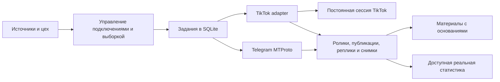

# Подключения и сбор источников v2

Этап аккаунтного TikTok-подключения и серверной выборки 10/20 реализован отдельно: [текущее поведение](tiktok-account.md). Полная миграция внешних источников и библиотеки из браузера на сервер этим этапом не выполнялась. Остальной текст сохраняет исходное архитектурное предложение.

Статус: архитектурное предложение от 17 ноября 2026 года. Пользователь попросил сначала исследовать варианты и спроектировать решение. Приложение, подключения и сохранённые сессии в рамках этого исследования не менялись. Новые TikTok-запросы с аккаунта пользователя не выполнялись.

Основания: [сравнение семи репозиториев](../research/TIKTOK-OSS-2026-11-17.md), [официальный доступ](../research/TIKTOK-ACCESS-2026-11-17.md), текущий код `server/tiktok`, `server/collection.ts`, `server/store.ts`, `src/features/sources/repository.ts` и `src/features/collection/useCollectionRun.ts`.

## Решение

Заменить гостевую подготовку полноценным управляемым подключением аккаунта. Постоянная сессия, проверенная личность, автоматический список своих роликов и сохранённая выборка принадлежат e-content. Библиотека чтения страниц располагается за заменяемым адаптером и не определяет пользовательский сценарий.

Основной локальный путь: отдельный постоянный профиль браузера для аккаунта TikTok, ручной вход на настоящем сайте и повторное использование действующей сессии. Инфраструктура — существующие Node, SQLite и Playwright. Не требуется превращать сайт в Electron или сразу переносить его на PostgreSQL/Redis.

Для реализации чтения страниц первый сравнительный кандидат — MIT-библиотека `davidteather/TikTok-Api` в отдельном локальном Python worker. Это кандидат, а не уже выбранная надёжная зависимость: без успешной проверки ответов, бюджета и восстановления аккаунта импортировать её генераторы в рабочий цикл нельзя. Если SDK не даёт преимущества, оставить Node-адаптер чтения обычного сайта под тем же новым управлением сессией. DTK — резервный сравнительный стенд, не целевая архитектура всего приложения. Сравнение и точные версии находятся в исследовании.

Это два отдельных решения: **как хранится и проверяется подключение** и **каким кодом читаются страницы**. SDK не должен создавать новую личность или заменять наш профиль при каждом задании. Если его фабрики контекста не позволяют сохранить одну и ту же рабочую сессию, он не проходит отбор.

## Что не так с текущим прототипом

Факты из локального кода, а не предположения о политике TikTok:

1. `guest.ts` явно отклоняет состояние с известными cookies вошедшего аккаунта. `reader.ts` отклоняет `source.accountId`. Сегодняшний пользовательский вход в этот коннектор не предусмотрен принципиально.
2. `PublicTikTokReader.read()` каждый раз запускает браузер и создаёт `newContext()` из последнего сохранённого снимка. В конце контекст закрывается. Изменения cookies/состояния, появившиеся за время обычного сбора, обратно не сохраняются.
3. `TikTokGuest.confirm()` делает снимок только после отдельного действия «Готово». Снимок по умолчанию содержит cookies/localStorage; это не постоянный профиль браузера. IndexedDB явно не запрашивается. Нельзя утверждать без наблюдений, что именно IndexedDB является причиной повторных проверок TikTok.
4. Ручная подготовка существует лишь в памяти сервера, привязана к одной UI-сессии и закрывается через десять минут. Перезапуск процесса теряет это незавершённое действие.
5. Список источников и настройки находятся в browser localStorage. Сервер получает снимок на запуск; отдельного реестра подключений и автоматически найденных роликов в SQLite нет. Проверочный запуск через API сам по себе не создаёт источник в интерфейсе пользователя.
6. Обход профиля собирает ссылки из DOM и берёт первые N. Это не проверенный алгоритм выбора последних N роликов по дате: старые закреплённые карточки могут попасть раньше свежих.
7. Импорт серверных идей в IndexedDB вызывается хуком цеха. Появление результата в материалах не должно зависеть от предварительного открытия главной страницы.

Эти недостатки объясняют неудобный процесс и неустойчивое повторное использование состояния. Они не устанавливают точную причину каждого запроса возраста/CAPTCHA. Повторную проверку сайт может потребовать и при правильно сохранённой действующей сессии.

Документация Playwright различает [снимок авторизации](https://playwright.dev/docs/auth) и [постоянный browser context с отдельным userDataDir](https://playwright.dev/docs/api/class-browsertype#browser-type-launch-persistent-context). Один каталог нельзя одновременно использовать несколькими экземплярами браузера; обычный пользовательский Chrome-профиль для такой автоматизации не подходит. Это основание для отдельного профиля и блокировки на подключение, не обещание бессрочного входа.

## Пользовательский сценарий

1. Нажать «Подключить TikTok». В отдельном окне настоящего TikTok самостоятельно войти выбранным доступным способом. e-content не предлагает свою форму для TikTok-пароля.
2. Приложение определяет фактический аккаунт, проверяет доступное чтение и автоматически показывает его профиль и ролики. Простого наличия cookie недостаточно для «Подключён».
3. Выбрать «Последние 10» или «Последние 20», при желании ограничить период и включить ответы. По умолчанию анализируется собственный подключённый профиль. Параметры сохраняются на сервере.
4. Запустить цех. Сервер сам получает список роликов, счётчики и комментарии; показывает число обработанных видео, сохранённых реплик и причину неполного результата.
5. Открыть материалы сразу после завершения. Идеи и основания уже сохранены и доступны без посещения промежуточных страниц.

Отдельная ссылка остаётся быстрым необязательным способом проверить конкретное видео. Для изучения чужого профиля достаточно добавить его `@имя` один раз; ролики выбираются автоматически. Подключение читателя и исследуемый профиль различаются: вход во второй аккаунт не делает его владельцем роликов основного.

Обычное повторное действие пользователя — «Обновить данные». «Войти снова» появляется только при подтверждённой потере авторизации. «Подтвердить в TikTok» относится к конкретной проверке сайта и после её прохождения повторяет проверку чтения автоматически; дополнительная постоянная гостевая кнопка не нужна. Закрытие окна без подтверждённого результата не считается успехом.

Пользовательское желание «авторизоваться один раз» означает сохранять и переиспользовать действующее подключение. Срок сессии контролирует TikTok, поэтому гарантировать отсутствие повторного входа нельзя.

## Модули и исполнение

Публичный интерфейс модуля подключений: начать подключение, прочитать его состояние, сохранить выборку, запустить синхронизацию, отключить. UI и будущий MCP вызывают одни прикладные операции. Они не получают cookies, SDK-объекты и браузерные курсоры.

Внутренние части:

| Часть                    | Ответственность                                                                          |
| ------------------------ | ---------------------------------------------------------------------------------------- |
| Управление подключениями | Проверенная личность, доступные возможности, сессия, актуальный статус, отключение       |
| Выборка контента         | Свой/наблюдаемый профиль, последние N, период, сохранённые исключения                    |
| Адаптер площадки         | Перечисление роликов и страниц комментариев, нормализация ответа, классификация ошибок   |
| Исполнитель              | Очередь, блокировки, бюджеты, отмена, сохранение прогресса и повтор задания              |
| Хранилище                | Канонические записи, история наблюдений, основания, пользовательские статусы и избранное |

Один browser context и последовательные задания на одно TikTok-подключение. Браузер не открывается заново для каждого ролика. Обновления состояния сохраняются при работе и при корректном закрытии. Если для пользовательского подтверждения требуется видимое окно, используется то же подключение; одновременно открывать тот же каталог второй процесс не должен.

Не менять браузер, обычный профиль пользователя или идентичность автоматически в ответ на отказ. Ни настройки постоянного профиля, ни отдельный читатель не дают гарантии отсутствия ограничений или риска для аккаунта.

Смена библиотеки ограничена адаптером. При отдельном Python worker связь с Node идёт локальным протоколом заданий/событий с ID, отменой и backpressure; произвольные пути, команды и cookies в ответы UI не передаются. Python-процесс не становится владельцем очереди или пользовательской базы.

## Сессия и состояния

Для подключения хранить проверенную платформенную личность, тип доступа, время успешной проверки и фактически подтверждённые возможности: профиль, свои ролики, публичные счётчики, комментарии, ответы. «Аккаунт подключён» не означает автоматически «все виды статистики доступны».

| Состояние           | Что происходит                                                    |
| ------------------- | ----------------------------------------------------------------- |
| Не подключён        | Доступно первое подключение                                       |
| Ожидает входа       | Пользователь работает на сайте TikTok                             |
| Проверяем доступ    | Проверяется личность и чтение, без фиктивного зелёного статуса    |
| Готов               | Существующая сессия используется для задания                      |
| Нужна проверка      | Конкретное чтение остановлено; доступно окно для ручного действия |
| Нужно войти снова   | Получено подтверждение истёкшей/отозванной авторизации            |
| Пауза площадки      | Сохранена причина и срок повтора, если он выдан площадкой         |
| Временно недоступен | Сетевой сбой, не доказательство потери аккаунта                   |

Сохранённый файл или `sessionid` не доказывает действительность авторизации. Проверять аккаунт нужно перед использованием сессии, переиспользуя недавний результат проверки, а не отправляя новые TikTok-запросы при каждом открытии UI. Для неофициального web-метода его успешный ответ и соответствие фактическому пользователю сначала подтверждаются в нашем окружении.

Пустой `200` сам по себе не становится CAPTCHA, баном, «нет комментариев» или причиной удалить cookies. Повтор допускается ограниченно для действительно временных сетевых ошибок. CAPTCHA/возраст/обязательный вход требуют ручного действия, не решателя или смены аккаунта. Условия автоматизированного доступа TikTok и риск ограничений не исчезают при входе в аккаунт; это не официальный API-доступ.

На локальном Windows профили и секреты находятся вне публичной директории, привязаны к пользователю ОС и исключены из Git. OAuth/MTProto секреты можно хранить с защитой ОС. Постоянный профиль браузера нельзя считать целиком зашифрованным только потому, что отдельные токены лежат в AES vault. Ключ рядом с базой не защищает от чтения самих файлов. Профиль не синхронизируется на VPS как обычный контент.

## Отбор роликов и сбор комментариев

«Последние 20» означает последние по дате публикации, а не первые карточки сетки. Закреплённые ролики, повторы и порядок ответа обрабатываются явно. Если неофициальный источник не позволяет доказать полноту списка, показывается число доступных найденных роликов и ограничение выборки.

Discovery получает страницы, нормализует стабильные строковые ID и даты, убирает повторы и формирует список задач. Комментарии и ответы обходятся отдельными страницами с проверкой принадлежности ролику и строгой дедупликацией. Даты и неизвестные счётчики не выдумываются. Нет остановки на первой старой реплике при недоказанном хронологическом порядке выдачи.

«10/20 роликов» — размер пользовательской выборки. Лимиты реплик/времени/обращений — отдельные ограничения ресурсов приложения, не официальные безопасные квоты TikTok. Проверяются реальные попытки, включая внутренние повторы SDK. Не окрашивать нагрузку как доказанный риск бана по произвольному числу комментариев.

Каждая полученная страница сохраняется до дальнейшего обхода. Повторное обновление объединяет записи по ID и не создаёт новые копии прежних идей. Последние известные комментарии не служат универсальным условием завершения: популярный порядок выдачи может сдвигать страницы. Повторно проверяется ограниченное перекрытие данных; покрытие и завершение фиксируются явно.

Долговечность внутреннего курсора SDK/TikTok не предполагается. Checkpoint содержит видео, этап, провайдера, версию адаптера, порядок/параметры и курсор. Если курсор отвергнут, перечитывается соответствующая задача с дедупликацией; весь уже завершённый список роликов не запускается заново. Отменённые/ограниченные результаты сохраняются.

В задании, ожидающем ручного подтверждения, сохраняются прогресс и причина ожидания. Оно освобождает исполнителя; это не глобальный запрет на Telegram и локальную обработку сохранённого. Начать можно с одного SQLite worker без Redis, с блокировкой на каждое подключение и последовательным исполнением готовых задач.

## Данные и источник истины

SQLite становится источником истины для реестра источников, выбора роликов, заданий и найденных идей. Browser localStorage остаётся для локальных предпочтений интерфейса, IndexedDB может быть кэшем. Материалы не должны импортироваться только при монтировании цеха.

Минимальные сущности: подключения; профили-цели анализа; сохранённые выборки; задания и задачи по видео; публикации/ролики; комментарии с root/parent; снимки метрик; идеи; основания; пользовательские статусы/приоритеты/избранное. Исходные записи и результат анализа разделены. Отчёт запуска не превращается в идею.

Ключ записи включает площадку и её стабильный ID. Идентификатор OAuth `open_id` и web user ID не считать одинаковыми: они имеют разные области действия. Объединять подключения и контент по одному совпавшему `@имени` нельзя; нужна подтверждённая связь личности/владения.

Публичные счётчики хранятся снимками с `observedAt`, провайдером, покрытием и nullable-полями. Отсутствие метрики не означает ноль. График роста из последовательных наблюдений начинается с нашего первого наблюдения, а не задним числом из одного текущего числа. Удержание, демография и источники просмотров не выводятся из счётчиков просмотров/лайков/репостов.

Миграция должна сохранить существующие источники, локальные идеи, ручные правки, избранное, архив и Markdown. Сначала одноразовый перенос с ревизией и проверкой результата; удалять старое локальное хранилище до проверки нельзя. Серверные задания больше не требуют открытия главной страницы для попадания идей в материалы.

## Официальные API

Если реальный Accounts API доступ для нашего приложения одобрен, использовать его для поддерживаемых собственных комментариев/ответов. Это предпочтительный отдельный адаптер. Для списка своих публичных видео и счётчиков Display API документирует страницы до 20, отсортированные по дате; текстов комментариев в его Video Object нет. [List Videos](https://developers.tiktok.com/docs/en/tiktok-api-v2-video-list), [Accounts Overview](https://business-api.tiktok.com/portal/docs/accounts-api-overview/v1.3).

Production-одобрение личного приложения не предполагается. Sandbox, Accounts и Research имеют различные условия; наличие одного OAuth-входа не даёт доступ ко всем продуктам. До подтверждения допуска не делать официальный путь обязательным условием бесплатного локального MVP. Подробности и ограничения перечислены в исследовании официального доступа.

Для OAuth брать сроки из ответа и атомарно сохранять ротацию токенов под блокировкой аккаунта. Текущая документация менялась, поэтому старые значения сроков нельзя зашивать в код. [OAuth lifecycle](https://developers.tiktok.com/docs/en/oauth-user-access-token-management).

Telegram остаётся отдельным MTProto-адаптером с сохраняемой сессией. Регистрация `api_id/api_hash` — отдельный однократный шаг; смена библиотеки не исправит отказ my.telegram.org создать приложение. Telegram [описывает получение ключей](https://core.telegram.org/api/obtaining_api_id), [привязку авторизации к ключу](https://core.telegram.org/api/auth) и [FLOOD_WAIT](https://core.telegram.org/api/errors). Сетевой сбой или cooldown не должен превращаться в запрос нового входа. Закрытие панели не завершает авторизацию или сбор.

## Порядок реализации и критерии выбора

1. Сравнительный опыт подключения: ручной аккаунтный вход, подтверждённая личность, закрытие/открытие окна, перезапуск backend и восстановление того же аккаунта. Обычный перезапуск не должен сам создавать новую гостевую личность. Нельзя считать отключённый браузер и потерянную авторизацию одним событием.
2. Автоматически перечислить 10, затем 20 роликов своего профиля; сверить ID и даты, включая старые закреплённые. Контроль полноты обязателен.
3. Прочитать комментарии и полные ветки нескольких выбранных видео с датами, длинными ID и строгим бюджетом. Сравнить SDK и наш reader на разных изолированных тестовых подключениях, не копируя одну и ту же профильную директорию одновременно двум браузерам. При отсутствии результата честно исключить адаптер.
4. Проверить сохранение по страницам, отмену, сбой сети, закрытие панели, запрос проверки, неверный курсор и повтор без дублей. Результат частичного TikTok не теряет завершённый Telegram.
5. Подключить серверный реестр источников и библиотеку, выполнить миграцию с сохранением ручных изменений. Обновить единый UI: подключение, выборка, запуск, результат.

Повторное ручное подтверждение при фактическом требовании площадки допустимо. Требование подтверждать гостевой доступ перед каждым штатным обновлением — провал пользовательского сценария и основание пересматривать адаптер. Один успешный запуск в день подключения не доказывает долговременную сессию; проверка должна включить несколько повторов и следующий день без искусственного изменения часов.

На этапе исследования ничего из этого не реализовано и не выдано за новый живой результат. Предыдущие 20 комментариев подтверждают возможность ограниченного чтения конкретного ролика, но не авторизованный профильный сбор или устойчивость на 20 роликах. Платные fallback, прокси и решатели не подключаются автоматически.
